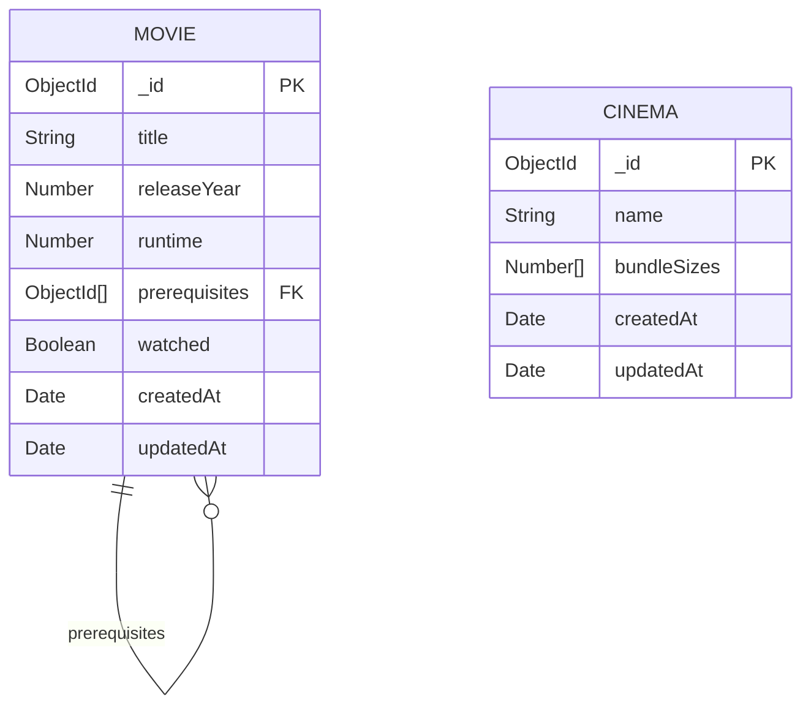

# ☢ Doomsday Ready

**Full-Stack Developer Internship Assessment — Blinto Talent Accelerator 2027**

---

## About the Project

Doomsday Ready is a full-stack web application built for the Blinto Talent Accelerator 2027 internship assessment.

With **Avengers: Doomsday** on the horizon, many Marvel fans want to rewatch the MCU films in the right order before opening night. This app helps them do exactly that — plan their rewatch journey and book a cinema watch party with friends.

It has two main purposes:

- **Rewatch Planning** — Add MCU movies, set prerequisites, and get a correct watch order using topological sort.
- **Cinema Booking** — Add cinemas with seat bundle sizes and calculate the minimum number of bundles needed for any group size.

---

## Features

### 🎬 Movies
- Add, view, and update movies (title, release year, runtime, watched status).
- Set prerequisite movies that must be watched first.
- Mark movies as watched or unwatched.
- Circular dependency detection — if adding a prerequisite would create a cycle, the API returns `409 CIRCULAR_DEPENDENCY`.

### 📋 Rewatch Plan
- Select any movie as your target.
- Get all prerequisite movies in the correct watch order (Kahn's topological sort).
- See how many movies you have already watched.
- See the total remaining watch time for unwatched movies.

### 🎟 Cinema Booking
- Add cinemas with their available seat bundle sizes.
- Enter a group size and get the minimum number of bundles needed to fill it exactly.
- If no exact combination is possible, the app clearly shows **Not Possible**.
- Uses a bottom-up dynamic programming approach (coin-change variant).

---

## Technology Stack

| Layer     | Technology                              |
|-----------|-----------------------------------------|
| Frontend  | Next.js 16, React 19, Tailwind CSS 4   |
| Backend   | Node.js, Express 5                      |
| Database  | MongoDB Atlas, Mongoose 9               |
| Language  | JavaScript (ES6+)                       |
| API Style | REST API                                |
| Version Control | Git, GitHub                      |

---

## Project Structure

```
Doomsday-Ready/
├── doomsday-client/        # Next.js frontend
│   ├── app/
│   │   ├── movies/
│   │   ├── rewatch-plan/
│   │   └── booking/
│   ├── components/
│   │   ├── layout/
│   │   ├── movies/
│   │   ├── rewatch/
│   │   ├── booking/
│   │   └── common/
│   └── services/
│       ├── api.js
│       └── tmdb.js
├── doomsday-server/        # Express backend
│   ├── controllers/
│   ├── models/
│   ├── routes/
│   └── config/
└── README.md
```

---

## Database Design



> Movies and Cinemas are **independent collections** — there is no relationship between them.
>
> A Movie's `prerequisites` field is an array of ObjectIds that reference other documents in the same Movie collection, forming a **directed acyclic graph (DAG)**. Adding a prerequisite that creates a cycle returns `409 CIRCULAR_DEPENDENCY`.

---

## API Endpoints

| Method | Endpoint | Description |
|--------|----------|-------------|
| `POST` | `/api/movies` | Create a new movie |
| `GET` | `/api/movies` | List all movies |
| `PATCH` | `/api/movies/:id` | Update a movie |
| `GET` | `/api/movies/:id/rewatch-order` | Get topological watch order |
| `POST` | `/api/cinemas` | Create a new cinema |
| `GET` | `/api/cinemas` | List all cinemas |
| `GET` | `/api/cinemas/:id/booking?groupSize=6` | Get minimum bundle booking quote |

---

## Installation & Setup

### Prerequisites
- Node.js 18+
- A MongoDB Atlas URI (or local MongoDB instance)

### 1. Clone the repository

```bash
git clone https://github.com/Mahabubislam50725/Doomsday-Ready.git
cd Doomsday-Ready
```

### 2. Backend setup

```bash
cd doomsday-server
npm install
```

Create a `.env` file inside `doomsday-server/`:

```env
PORT=5000
MONGO_URI=your_mongodb_atlas_uri_here
```

Start the server:

```bash
npm run dev
```

The API will be available at `http://localhost:5000`.

### 3. Frontend setup

```bash
cd ../doomsday-client
npm install
```

Create a `.env.local` file inside `doomsday-client/`:

```env
NEXT_PUBLIC_API_URL=http://localhost:5000/api
NEXT_PUBLIC_TMDB_KEY=your_tmdb_api_key_here
```

Start the frontend:

```bash
npm run dev
```

The app will be available at `http://localhost:3000`.

---

## AI Usage Disclosure

During this project, I used AI tools (Amazon Q) as a supporting resource — for understanding technical concepts, exploring implementation approaches, debugging issues, and speeding up boilerplate code like Express setup, Mongoose schemas, and Next.js UI components.

The core logic — circular dependency detection (DFS traversal), topological sort (Kahn's algorithm), and the booking DP (coin-change minimum bundles) — was designed and implemented by me. I reviewed, adapted, and worked to understand every part of the codebase rather than blindly copying generated output.

---

## Developer

Submitted for the **Blinto Talent Accelerator 2027 — Full-Stack Developer Internship Assessment**.

GitHub: [github.com/Mahabubislam50725](https://github.com/Mahabubislam50725)
